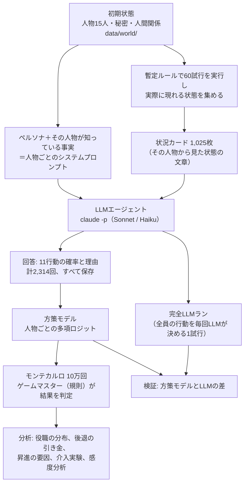

# シミュレーションの仕組み

このページは、hanzawa-sim がどのような仕組みで「半沢直樹」の登場人物の10年間をシミュレーションしているかを説明します。結果の解説は [results.md](results.md) にあります。

## 目次

1. [全体の流れ](#1-全体の流れ)
2. [初期状態（2013年10月の東京中央銀行）](#2-初期状態2013年10月の東京中央銀行)
3. [LLMエージェント](#3-llmエージェント)
4. [状況カードと方策の抽出](#4-状況カードと方策の抽出)
5. [方策モデル（蒸留）](#5-方策モデル蒸留)
6. [ゲームマスター（1半期の処理）](#6-ゲームマスター1半期の処理)
7. [乱数と再現性](#7-乱数と再現性)
8. [分析の方法](#8-分析の方法)
9. [検証](#9-検証)
10. [設計上の判断と限界](#10-設計上の判断と限界)
11. [コードとの対応](#11-コードとの対応)

---

## 1. 全体の流れ

### 課題

条件は次の4つです。

- 各登場人物を独立した AI エージェントにする
- 各人物の知識・役職・人間関係はドラマと同じにする
- ある時点から10年間をシミュレーションし、10年後の役職の分布を10万回の試行で求める
- 昇進・降格の要因とイベントを分析する

15人が半期ごとに20回行動を決めると、1試行あたり約300回、10万回で約3,000万回の LLM 呼び出しが必要です。1回5秒としても約4.8年かかり、実行できません。

### 二段階の方式

そこで、LLM エージェントの判断を統計モデルに写し取り（蒸留）、10万回はその統計モデルで実行します。



| 段階 | LLM 呼び出し | 所要時間 |
|---|---|---|
| 方策の抽出（状況カードへの回答） | Sonnet 1,157回、Haiku 1,158回 | 45分（6並列） |
| 方策モデルの学習 | なし | 数秒 |
| 10万回のモンテカルロ | なし | 24分（CPU 8コア） |
| 完全LLMラン1回 | Sonnet 189回 | 2.3分 |

LLM の呼び出し回数はカードの枚数で決まり、試行回数には依存しません。10万回の試行では、ある結果の確率の95%信頼区間の半幅は最大でも ±0.31 ポイントです。

---

## 2. 初期状態（2013年10月の東京中央銀行）

2013年版の最終回（第10話）の直後を初期状態とします。半沢直樹は東京セントラル証券への出向を命じられ、大和田暁は常務から取締役に降格されています。

### 人物

名前付きの人物は15人です（`data/world/persons.yaml`）。

| 人物 | 派閥 | 所属・ランク | 2013年の年齢 | 年齢の根拠 |
|---|---|---|---|---|
| 半沢直樹 | 旧S | 証券子会社に出向（格は次長、ランク3） | 42 | Wikipedia の記述 |
| 大和田暁 | 旧S | 取締役（ランク6） | 56 | Wikipedia の記述 |
| 中野渡謙 | 旧T | 頭取（ランク10） | 63 | 入行年から推定 |
| 渡真利忍 | 旧S | 融資部 調査役（ランク2） | 43 | 入行年から推定 |
| 近藤直弼 | 旧S | 広報部 調査役（ランク2） | 43 | 入行年から推定 |
| 内藤寛 | 旧S | 営業第二部長（ランク4） | 54 | 俳優の生年で代用 |
| 黒崎駿一 | 金融庁 | 主任検査官（金融庁ランク2） | 41 | 俳優の生年で代用 |
| 高木 | 旧T | 専務（ランク8） | 60 | 俳優の生年で代用 |
| 岸川慎吾 | 旧S | 取締役から出向 | 60 | 俳優の生年で代用 |
| 福山啓次郎 | 旧S | 融資部 次長（ランク3） | 40 | 俳優の生年で代用 |
| 浅野匡 | 旧S | マニラの企業に出向（元支店長、ランク4） | 52 | Wikipedia の記述 |
| 小木曽忠生 | 旧S | 出向（元人事部次長、ランク3） | 49 | 俳優の生年で代用 |
| 江島浩 | 旧S | 大阪西支店 副支店長（ランク3） | 47 | 俳優の生年で代用 |
| 貝瀬郁夫 | 旧S | 京橋支店長（ランク4） | 52 | 俳優の生年で代用 |
| 古里則夫 | 旧S | 京橋支店 課長代理（ランク1） | 51 | 俳優の生年で代用 |

旧S＝旧産業中央銀行、旧T＝旧東京第一銀行です。各人物には、能力（0〜1）と性格の数値（野心、攻撃性、誠実さ、忠誠、執念深さ、派閥への偏り、身内びいき、組織防衛）を持たせています。性格の数値は、ゲームマスターの一部の判定（恨みの薄れ方、ドラマに登場しない頭取の処分の寛大さなど）に使います。人物の行動の選び方は、性格の数値ではなく、LLM の回答から学習した方策で決まります。

### ランクと所属区分

| ランク | 銀行 | 定員 | 金融庁 |
|---|---|---|---|
| 10 | 頭取 | 1 | |
| 9 | 副頭取 | 2 | |
| 8 | 専務 | 3 | |
| 7 | 常務 | 6 | |
| 6 | 取締役 | 8 | 審議官 |
| 5 | 執行役員 | 12 | 課長 |
| 4 | 部長・主要支店長 | | 主任統括検査官 |
| 3 | 次長・副支店長 | | 統括検査官 |
| 2 | 調査役・課長 | | 主任検査官 |
| 1 | 課長代理以下 | | 検査官 |

所属区分は、本部・支店・出向・転籍・退職・失脚・外部（金融庁）の7つです。

### ドラマに登場しない人物（NPC）

役員の席のうち、名前付きの人物が座っていない席はドラマに登場しない人物（NPC）で埋めます。年齢・能力（0.45〜0.9）・派閥は試行ごとに乱数で決めます。執行役員の席を争う部長級の NPC も30人置き、退職などで減ったら補充します。NPC の行動は簡単な規則で決めます（ほとんどが業務専念、一部が根回し・静観・不正）。

### 秘密（不正）

秘密は、主体（不正をした人物）、共犯、重大度（0〜1）、公然か、処分済みか、そして「誰がどの強さの証拠を持っているか」で表します（`data/world/secrets.yaml`）。

| ID | 主体 | 内容 | 重大度 | 初期の状態 | 証拠を持つ人物（強さ） |
|---|---|---|---|---|---|
| S1 | 大和田（共犯 岸川） | 妻の会社への迂回融資と、伊勢島ホテルへの不正融資 | 0.8 | 公然・処分済み | 6人 |
| S2 | 浅野 | 西大阪スチールの東田と結託し5,000万円を受け取った | 0.9 | 非公然 | 半沢 0.9 |
| S3 | 黒崎（共犯 岸川） | 岸川の娘との婚約を伏せたまま検査を指揮した | 0.5 | 非公然 | 半沢 0.8 |
| S4 | 大和田 | 近藤に復帰を約束して報告書を渡させた | 0.5 | 非公然 | 近藤 1.0、半沢 0.5、渡真利 0.4 |
| S5 | 半沢 | 金融庁検査の際に資料を行外へ移した（疎開資料） | 0.5 | 非公然 | 黒崎 0.2 |
| S6 | 半沢 | 黒崎との関係を公表すると岸川を脅し、証言させた | 0.3 | 非公然 | 岸川 1.0 |
| S9 | 福山（共犯 岸川） | 岸川の命令で偽の疎開資料を作った | 0.6 | 非公然 | 半沢 0.9 |
| S10 | 貝瀬（共犯 古里） | 伊勢島ホテルの運用損失の内部告発を黙認した | 0.5 | 非公然 | 大和田 1.0、半沢 0.8、渡真利 0.7、近藤 0.7 |

このほか、弱みにはならないが人物の動機に関わる事実を2つ、知識としてだけ持たせています。

- S7: 大和田が半沢の父の工場への融資を打ち切った（半沢と大和田が知っている）
- S8: 中野渡が大和田を降格で留め、半沢を出向させた意図（中野渡だけが知っている）

シミュレーションの途中では、不正の行動や発覚した妨害から新しい秘密が生まれます。

### 人間関係

人物の組ごとに、信頼・敵意・借りの3つの値（0〜1）を持たせています。初期値は47本の有向の関係です（`data/world/relations.yaml`）。たとえば、半沢から大和田への敵意は 0.95（父の仇、役員会議で土下座させた）です。

---

## 3. LLMエージェント

### エージェントの独立

各人物のエージェントは、次の4つの条件で独立させています。

1. 人物ごとに別の LLM 呼び出しを行い、文脈を共有しない
2. 各人物は、自分が知っている事実だけを受け取る（部分観測）
3. 人物どうしは直接話さない。行動の結果は、規則で判定するプログラム（ゲームマスター）が決める
4. 人物どうしの影響は、ゲームマスターを通した行動の結果（告発、取引、妨害、支援など）だけで生じる

### システムプロンプト

各人物のシステムプロンプトは、次の部分からなります（`src/hanzawa_sim/agents/persona.py`）。

| 部分 | 内容 | 出典 |
|---|---|---|
| 人物像 | 経歴、性格 | `data/personas/personas.yaml`（独自の言葉で書いたもの） |
| 2013年9月時点の境遇 | 最終回で何が起きたか | 同上 |
| 価値観・目標・話し方 | | 同上 |
| 主な人物の立場 | 14人の役職（周知の事実） | `persons.yaml` から自動生成 |
| あなたが知っている不正・秘密 | その人物が証拠を持つ秘密だけ。証拠の強さを言葉で示す | `secrets.yaml` から自動生成 |
| あなたから見た人間関係 | 信頼・敵意・借りを言葉で示す | `relations.yaml` から自動生成 |
| 行動の選択肢と回答の規則 | | 固定の文 |

知識の部分は YAML から機械的に作るので、ある人物が知らない秘密がその人物のプロンプトに入ることはありません。たとえば、浅野の5,000万円の件（S2）は浅野と半沢のプロンプトにだけ入ります。テスト（`tests/test_agents.py`）で確認しています。

回答の規則では、次のことを指示しています。

- あなたは2013年9月時点のこの人物で、その後のことは状況カードに書かれた内容しか知らない
- 知っていると書かれていない他人の秘密を推測で補わない
- 正しい行動ではなく、この人物が実際に取りそうな行動を答える

ペルソナには2020年版で描かれる変化（半沢が頭取を目指すと決めることなど）を入れていません。

### 呼び出し方法

Claude Code のサブスクリプションの利用枠で、次のように呼び出します（`src/hanzawa_sim/agents/llm.py`）。

```bash
claude -p --safe-mode --tools "" --no-session-persistence \
  --model sonnet --system-prompt-file <人物のプロンプト> \
  --output-format json --json-schema <回答の形式> "<状況カード>"
```

- `--safe-mode` で、利用者の CLAUDE.md・ルール・MCP・フックを読み込まない
- `--tools ""` で、エージェントに道具（ファイル操作など）を使わせない
- `--json-schema` で回答の形式（各行動の確率、理由）を固定する

すべての呼び出しのプロンプトと回答は JSONL に保存し、公開しています（`data/elicitation/`）。

---

## 4. 状況カードと方策の抽出

### 行動の選択肢

各人物は半期ごとに次の11の行動から1つを選びます。

| 行動 | 内容 |
|---|---|
| 業務専念 | 本業に集中して成果を上げる |
| 静観 | 目立つ行動を控える |
| 隠蔽 | 自分の不正の証拠を消す、口止めする |
| 不正 | 規則に反する手段で目先の成果を得る |
| 退職 | 銀行を辞める |
| 証拠収集 | 最も敵対している相手の不正の証拠を集める |
| 告発 | 握っている相手の不正を公にする（失敗すると自分が処分されるおそれ） |
| 取引 | 弱みを材料に見返りを求める、または自分の弱みを握る相手を懐柔する |
| 妨害 | 敵の仕事を妨げる |
| 根回し | 有力者に近づき、後ろ盾を得る |
| 支援 | 味方の仕事を助け、味方の敵についての情報を渡す |

### 状況カード

状況カードは、ある時点の世界の状態を、その人物から見た文章にしたものです。カードの各行は、方策モデルが使う16個の特徴と1対1に対応しています（`src/hanzawa_sim/agents/features.py`、`cards.py`）。

| 特徴 | カードでの表現 |
|---|---|
| 自分のランク、出向中か、銀行外か | あなたの立場（年齢つき） |
| 定年・任期の上限までの年数 | 残り約○年 |
| 直近の業績 | 好調・普通・不振 |
| 敵がいるか、敵との影響力の差 | 最も敵対している相手と、その影響力（あなたより大きい・同程度・小さい） |
| 敵の不正について自分が持つ証拠の強さ | 相手の弱み（確かな証拠・ある程度の証拠・弱い証拠・握っていない） |
| 自分の秘密が他人に握られている度合い | あなたの弱み（危険度: 高い・中程度・低い） |
| 後ろ盾の強さ | 役員の後ろ盾（強い・弱い・ほぼない） |
| 頭取の自分への態度 | 好意的・中立・冷淡 |
| 頭取が同じ派閥か | 頭取の派閥 |
| 前の半期に攻撃を受けたか | はい・いいえ |
| 1つ上の役職に空席があるか | ある・ない |
| 自分が頭取か、味方がいるか | 頭取: あなた自身、頼れる味方 |

状態によって選べない行動はカードに明記し、回答でも0にさせます。たとえば、敵がいなければ証拠収集・妨害は選べず、相手の秘密の証拠を持っていなければ告発は選べません。

カードの例（半沢、Sonnet への実際の入力）:

```
【状況 hanzawa-r0s0】2014年4月時点
- あなたの立場: 東京中央銀行 次長・副支店長（本部、43歳）
- 定年・任期の上限までの残り: 約10年
- 直近の業績: 好調
- 頭取: 中野渡謙。あなたへの態度は好意的
- 頭取の派閥: あなたとは別
- 最も敵対している相手: 大和田暁（取締役・旧S出身）。影響力はあなたより大きい
- 相手の弱み: 「出向中の近藤に銀行への復帰を約束し、迂回融資の報告書を渡させた（証拠の握りつぶし）」について、あなたはある程度の証拠を持っている
- あなたの弱み: あなたの秘密を他に知っている者がいる（危険度: 低い）
- 役員の後ろ盾: 強い
- 頼れる味方: 渡真利忍（調査役・課長・旧S出身）
- 近づける有力者: 中野渡謙（頭取・旧T出身）
- 前の半期に攻撃を受けた: はい
- 1つ上の役職の空席: ない
- 選べる行動: work, lie_low, cover_up, misconduct, resign, gather, expose, bargain, undermine, lobby, support
```

このカードへの Sonnet の回答は、業務専念 40%、証拠収集 28%、支援 16%、根回し 5%、静観・隠蔽・告発 各3%、不正 1%、その他 1% でした。理由は「攻撃を受けた直後でも、まず目の前の仕事で結果を出し、部下や渡真利ら仲間を守る。同時に父の仇の大和田については、証拠がまだ十分でないので、決定打になるよう情報を集め続ける。」です。

### カードの選び方

カードの状態は、実際のシミュレーションで現れる状態から選びます。

1. 暫定ルール（性格の数値から行動を決める簡単な規則）で60試行を実行し、各半期の各人物の状態を集める
2. 特徴ベクトルを標準化し、半分は互いに最も離れた状態を順に選び（最遠点選択）、残りの半分は無作為に選ぶ
3. 主要7人（半沢、大和田、中野渡、渡真利、近藤、内藤、黒崎）は100枚、その他7人は40枚。うち2割を検証用にする（岸川は60歳で出向中のため最初の半期で退任し、カードを作れる状態が現れなかった）

最遠点選択だけでは珍しい状態に偏るため、無作為に選んだカードを混ぜています。

### 1枚ずつ答えさせる理由

パイロット（18回の呼び出し）で、5枚をまとめて答えさせた場合と1枚ずつの場合を比べました。まとめた場合、弱みや証拠が書かれたカードで回答の差が大きく（全変動距離 0.27・0.33）、LLM 自体の再回答の差（0.10）を超えました。同時に見た他のカードとの対比で、違いが誇張されると考えられます。キャッシュが効くため費用はほぼ変わらないので、本番は1枚ずつ答えさせました。

### 行動以外のカード

| カード | 内容 | 枚数（各モデル） | 使い道 |
|---|---|---|---|
| 取引への応答 | 脅しまたは懐柔を受けたときに、応じる・断る・対抗する の確率 | 41 | 取引の結果の判定 |
| 処分の判断 | 頭取として、不正の重大さ・証拠・役員か・派閥・関係の組み合わせに対して、注意・降格・出向・解任 の確率 | 32（頭取になりうる4人×8） | ドラマの人物が頭取のときの処分 |
| 人事の好み | 頭取として、属性の違う2人の候補のどちらを選ぶか（コンジョイント） | 40（4人×10） | ドラマの人物が頭取のときの役員選任 |
| 再現テスト | 2013年版の9場面を仮定の状況として示す | 9 | 検証 |
| 予測 | 「これから1〜2年に何が起きると思うか」 | 15 | 2020年版の情報の漏れの検査 |
| 再回答 | 主要7人×4枚を同じ条件でもう一度 | 28 | LLM 自体のばらつき |
| 名前を伏せた版 | 人物名・組織名を別の名前に置き換えたカード | 12 | LLM の事前知識の影響 |

取引への応答のカードは、暫定ルールの試行で取引が起こりうる状態（相手が自分の秘密を握っている／自分が相手の秘密を握っている）から作りました。人事の好みの候補の属性は、派閥・業績・能力・頭取との関係・処分歴・年齢・他の役員の支持の7つで、2人の候補ごとに無作為に変えます。

Sonnet と Haiku の両方に同じカードを答えさせ、どちらの回答から学習した方策でも10万回のシミュレーションを実行できるようにしています。

---

## 5. 方策モデル（蒸留）

### 行動の方策

人物 g が状態 x（16個の特徴）で行動 a を選ぶ確率を、多項ロジットで表します。

```
P(a | x, g) = exp(W_g[a] · [1, x]) / Σ_{a' ∈ 選べる行動} exp(W_g[a'] · [1, x])
W_g = B + D_g
```

- B は全員に共通の部分、D_g は人物ごとの差分。D_g を L2 正則化で0に寄せることで、カードの少ない人物は共通の部分に近づく
- 学習は、LLM が答えた確率分布 p と、モデルの確率 q の交差エントロピー −Σ p log q に L2 正則化を加えたものを最小化する（L-BFGS）
- 正則化の強さは、学習用カードでの5分割交差検証で選ぶ

### その他のモデル

取引への応答（3択）、処分の判断（4択）、人事の好み（2択）も、同じ形の多項ロジットで学習します。人事の好みは、候補Aと候補Bの属性の差 Δx を使い、P(Aを選ぶ) = σ(β · Δx) とします。β は頭取ごとの「何を重視するか」の重みです。

学習したモデルは `data/policies/<モデル>.json` に保存し、シミュレーションで読み込みます（`src/hanzawa_sim/agents/policy.py`）。

---

## 6. ゲームマスター（1半期の処理）

ゲームマスターは、行動の結果と人事を規則で判定します（`src/hanzawa_sim/sim/engine.py`）。1試行は2013年10月から始まる20半期（10年）です。各半期は次の順で処理します。

1. 介入（介入実験のときだけ）
2. 外生イベント
3. 行動の宣言と解決
4. 人事（役員人事は年1回、4〜9月の半期）
5. 人間関係の変化

### 6.1 共通の量

| 量 | 定義 |
|---|---|
| 影響力 | 銀行内: ランク/10。出向中: ランク/20。金融庁: 0.3 + 0.1×ランク |
| 後ろ盾 | 取締役以上の人物 k について、clip(信頼 + 0.5×借り − 敵意) × k の影響力 の最大値 |
| 敵 | 自分の敵意が最も強い相手（敵意 0.2 以上） |
| 味方 | 自分の信頼が最も強い相手（信頼 0.3 以上） |
| 有力者 | 自分より影響力の大きい銀行内の人物のうち、影響力×(0.5 + 相手から自分への信頼 − 敵意) が最大の人物 |
| 秘密の新しさ | 0.5^(経過年数/4)。古い秘密ほど露見しにくい |

### 6.2 外生イベント

| イベント | 確率・内容 |
|---|---|
| 業績の変動 | 業績 ← 0.5×前の業績 + 0.5×2(能力−0.5) + 0.35×正規乱数 |
| 大型案件の失敗 | ランク2以上の行員1人あたり 1%/半期（業績不振で1.5倍、能力が高いほど低い）。重大度 0.15〜0.5 の処分の対象になる |
| 金融庁検査 | 25%/半期。金融庁でランク4以下の人物（黒崎など）が検査を指揮する。銀行員の非公然の秘密それぞれについて、発覚の確率は (0.03 + 指揮者がいれば0.04)×新しさ + 0.25×指揮者が持つ証拠の強さ |
| 偶発的な露見 | 秘密ごとに 0.005 × 知っている人数 × 最も強い証拠 × 新しさ |
| 派閥の過去の不祥事 | 1.5%/半期。無作為に選んだ派閥の最上位の役員が、重大度 0.4〜0.9 の処分の対象になる（2020年版の具体的な不祥事は使わず、一般化している） |

### 6.3 行動の解決

全員が同時に行動を宣言し、試行ごとの乱数で決めた順に解決します。

| 行動 | 判定 |
|---|---|
| 業務専念 | 業績 + 0.35×能力、評判 +0.03 |
| 静観 | 他人から自分への敵意 ×0.9 |
| 隠蔽 | 自分の秘密の証拠を持つ各人物について、70%の確率でその証拠 ×0.6。10%の確率で秘密の重大度 +0.1（隠蔽が新たな不正になる） |
| 不正 | 業績 +0.5。重大度 0.3〜0.7 の新しい秘密が生まれる。30%の確率で、自分に敵意を持つ人物に弱い証拠（0.3）を握られる |
| 退職 | 退職する |
| 証拠収集 | 敵の秘密をすでに知っていれば、その証拠が 0.1〜0.3 強まる。知らなければ 25%×新しさ の確率で敵の秘密を見つける（証拠0.3）。20%の確率で相手に気づかれ、相手の敵意 +0.2 |
| 告発 | 成功の確率 = σ(4(証拠−0.5) + 1.5×重大度 − 1.5×相手の守り + 告発者の信用 + 金融庁なら1)。相手の守り = 影響力 + 0.5×後ろ盾（+0.5 相手が頭取なら）。信用 = 0.5×評判 + 影響力。成功すると秘密が公になり処分へ。失敗すると相手の敵意 +0.5、50%の確率で告発者が処分の対象になる（重大度 0.25 + 0.4×相手の影響力） |
| 取引 | 相手の秘密の証拠（0.3以上）を持っていれば脅し、自分の秘密を握る相手がいれば懐柔。相手は学習した応答モデルで 応じる・断る・対抗する を選ぶ。応じると、脅しでは相手が借りを負い、懐柔では相手が証拠を手放す。対抗すると、相手は握っている証拠で告発するか、妨害する |
| 妨害 | 50%の確率で敵の業績 −0.4。30%の確率で発覚し、重大度0.3の秘密になり（相手が証拠0.6を持つ）、相手の敵意 +0.3 |
| 根回し | 有力者から自分への信頼 + 0.15×(1−信頼)×(1−敵意) |
| 支援 | 味方の業績 +0.25、味方からの信頼 +0.1。味方が敵意を持つ相手の秘密を知っていれば、その証拠を味方に渡す（0.8倍の強さ） |

### 6.4 処分

秘密が公になると、主体と共犯（重大度0.7倍）が処分の対象になります。処分のスコアは次のとおりです。

```
s = 重大度 × (0.5 + 0.5×証拠) + 一様乱数(−0.15, 0.15) − 寛大さ
```

| s | 処分 | 結果 |
|---|---|---|
| 0.25 未満 | 注意 | 処分歴が増える |
| 0.25〜0.45 | 降格 | ランク −1 |
| 0.45〜0.65 | 出向 | 出向（出向中なら転籍） |
| 0.65〜0.85 | 解任 | 失脚 |
| 0.85 以上 | 刑事告発 | 失脚 |

- 頭取がドラマの人物（中野渡、高木、大和田、内藤）のときは、その人物の「処分の判断」の回答から学習したモデルで処分を選ぶ（刑事告発の重さのときを除く）
- 頭取がドラマに登場しない人物のときは、寛大さ = 0.5×組織防衛×(役員なら1、それ以外0.3) + 0.2×身内びいき×(信頼−敵意) とする。0.5 という値は、最終回で中野渡が大和田（重大度0.8）を取締役への降格で留めた判断が再現されるように決めた
- 頭取自身が対象のときは、s が 0.35 以上なら引責辞任
- 金融庁検査で発覚した場合は重大度を1.2倍にする

### 6.5 人事

| 人事 | 規則 |
|---|---|
| 頭取の退任 | 年1回、12%（68歳以上は +15%）。72歳で必ず退任 |
| 頭取の後継 | 常務〜副頭取（いなければ取締役、執行役員）のうち70歳未満から選ぶ。通常は前頭取の指名に取締役会の支持を40%加味する。不祥事による辞任では取締役会が選ぶ |
| 役員の定年 | 執行役員・取締役60歳、常務62歳、専務63歳、副頭取64歳 |
| 役員の選任 | 年1回、空席を上のランクから埋める。候補は1つ下のランクで、在任2年以上、定年まで半年以上ある人物 |
| 非役員の昇進 | 名前付きの人物のみ。在任2.5年以上で、半期ごとに確率 σ(基準 + 業績 + 能力 + 後ろ盾 + 頭取との関係 − 処分歴 + 評判 − 年齢の減点) |
| 出向からの復帰 | 52歳未満、半期ごとに確率 σ(−2 + 業績 + 能力 + 後ろ盾 + 頭取との関係 − 処分歴) |
| 年次による出向 | 50歳以上の行員（部長は53歳以上）、半期ごとに 25%×(1 − 0.6×後ろ盾) |
| 転籍 | 出向中で55歳以上、半期ごとに30% |
| 定年 | 出向中または部長以下で60歳 |
| 金融庁 | 在任2年以上で、半期ごとに確率 σ(−1.5 + 業績 − 1.5×処分歴)。60歳で退官 |

役員の選任と頭取の後継は、候補ごとの点数に Gumbel 乱数を加えて最大の人を選びます（多項ロジットと同じ選び方）。

```
選ばれる人 = argmax_c ( 点数_c / 0.5 + Gumbel 乱数_c )
```

点数は、頭取がドラマに登場しない人物のときは、業績・能力・後ろ盾・関係・派閥・年齢・処分歴・評判の重み付きの和です。頭取がドラマの人物のときは、その人物の「人事の好み」から学習した重み β で、候補の属性（同じ派閥か、業績、能力、頭取との関係、処分歴、若すぎるか、他の役員の支持）を評価した値を使います。2択の回答のロジットと尺度を合わせるため、β による値に 0.5 を掛けて点数に入れます。

各ランクには就任の年齢の目安（部長44歳、執行役員50歳、常務55歳など）があり、それより若い候補は1歳あたり0.8点減点します。常務55歳は、大和田が「歴代最速・最年少」で常務になり2013年時点で56歳という作中の記述に合わせました。

### 6.6 人間関係の変化

- 敵意は半期ごとに 0.94〜1.0 倍に薄れる（執念深い人物ほど薄れにくい）
- 信頼は 0.98 倍、借りは 0.95 倍
- 行動の結果（告発、妨害、根回し、支援、取引）で増減する

---

## 7. 乱数と再現性

各試行は、試行番号とシードから作る乱数表 U[半期, 用途, 人物・秘密, 枠]（20×13×256×8）だけを使います。用途は、行動の選択、行動の成否、業績、案件の失敗、発覚、処分、人事、昇進など13種類に分けています。

この作りにより、介入実験で1つの出来事を変えても、無関係な抽選には同じ乱数が使われます（共通乱数法）。基準シナリオと介入シナリオの差を、試行ごとの対の差として小さい誤差で推定できます。同じシードと試行番号からは、同じ結果が再現されます（`tests/test_world.py`）。

---

## 8. 分析の方法

試行ごとに全イベントを記録し、各イベントに原因となったイベントへのリンクを持たせています（例: 処分 ← 秘密の公表 ← 告発 ← 証拠収集）。集計は並列に実行するワーカーの中で行います（`src/hanzawa_sim/analysis/collect.py`）。

| 分析 | 方法 |
|---|---|
| 10年後の状態 | 人物ごとのカテゴリ（頭取〜失脚）の割合と95%信頼区間 |
| 役員経験 | 10年間に一度でもランク5以上になった割合 |
| 頭取の推移 | 毎年9月末の頭取の割合 |
| 後退の引き金 | 降格・出向・転籍・退職・失脚ごとに直接の原因をたどり、処分の場合は「誰の告発か」「どの秘密か」まで遡る |
| 対立の構造 | 「A が B の処分の原因になった」件数 |
| 昇進の要因 | 役員の選任で、選ばれた人と次点の候補の点数の差を項目ごとに平均する |
| 介入実験 | 最初の半期に1つの出来事を強制する（秘密の公表、退任、ある行動の禁止）。同じ試行番号で基準シナリオと比べた対の差の平均と95%信頼区間 |
| 感度分析 | 不確かなパラメータ9個を1つずつ0.5倍・1.5倍に変え、対の差で比べる |
| バックテスト | 2020年版の物語の時期（2015年4月）に、劇中の事実が成り立つ確率 |
| 動機 | LLM が書いた行動の理由を語のパターンで6種類に分類する |

因果効果の主張は介入実験の結果だけで行い、後退の引き金や昇進の要因は「モデルの中での関連」として扱います。

---

## 9. 検証

| 検証 | 何を確かめるか | 結果（Sonnet） |
|---|---|---|
| 方策モデルの誤差 | 検証用カード196枚で、方策モデルの確率と LLM の回答の全変動距離 | 0.078 |
| 比較: 状況を見ないモデル | 人物ごとの平均の分布を返すだけのモデル | 0.108 |
| LLM 自体のばらつき | 同じカードへの再回答の差（28組） | 0.047 |
| 完全LLMラン | 全員の行動を毎半期 LLM に決めさせた1試行で、実際に現れた状態での方策モデルとの差（189件） | 0.105 |
| 再現テスト | 2013年版の9場面で、劇中の行動に最も高い確率がつくか | 7/9 |
| 情報の漏れ | 「これから1〜2年に起きること」の予想に2020年版の固有名詞が出るか（15人） | 出なかった |
| 事前知識の影響 | 人物名・組織名を伏せた版との差（12組） | 0.123（再回答の差 0.056 の約2倍） |
| モデルの違い | Sonnet と Haiku の同じカードへの回答の差（980組） | 0.256 |

完全LLMランでは、各人物に状況カードに加えて「これまでの出来事」（その人物が知りうる人事異動、告発、取引）を記憶として渡しました。方策モデルは記憶を見ないため、完全LLMランでの差（0.105）が検証用カードでの差（0.078）より大きいことには、この違いも含まれます。

---

## 10. 設計上の判断と限界

- **規則とパラメータ**: 告発の成功率、処分の閾値、人事の点数の重みなどは、作品の場面と日本の大手銀行の慣行を参考に決めた値で、データから推定したものではない。感度分析で主な9個の影響を示した
- **年齢**: 作中に記述がない人物の年齢は、演じた俳優の生年で代用した。年齢は年次による出向と役員の年齢の上限を通じて結果に強く効く
- **LLM の事前知識**: LLM は作品を知っている。名前を伏せると回答が変わるため、回答にはペルソナに加えて LLM が知っている人物像が入っている。2020年版の内容は、予想の検査では出てこなかった
- **モデルによる違い**: Sonnet と Haiku の回答の差は大きく、どちらの方策を使うかで結果が変わる。結果のページで両方を示した
- **データの量**: 処分の判断は頭取1人あたり8枚で、頭取の間の違いは推定できなかった
- **NPC**: ドラマに登場しない人物の行動は簡単な規則で決めており、LLM エージェントではない

---

## 11. コードとの対応

| 内容 | ファイル |
|---|---|
| 人物・秘密・関係のデータ | `data/world/persons.yaml`、`secrets.yaml`、`relations.yaml` |
| ペルソナ | `data/personas/personas.yaml` |
| パラメータ | `src/hanzawa_sim/world/params.py` |
| 世界の構築（NPC の生成を含む） | `src/hanzawa_sim/world/loader.py` |
| ゲームマスター | `src/hanzawa_sim/sim/engine.py` |
| 乱数表 | `src/hanzawa_sim/sim/rng.py` |
| 特徴量とカードの文面 | `src/hanzawa_sim/agents/features.py`、`cards.py`、`special_cards.py` |
| システムプロンプト | `src/hanzawa_sim/agents/persona.py` |
| LLM の呼び出しと記録 | `src/hanzawa_sim/agents/llm.py` |
| 方策の学習 | `src/hanzawa_sim/agents/distill.py`、`scripts/fit_policies.py` |
| 方策の適用 | `src/hanzawa_sim/agents/policy.py` |
| 完全LLMラン | `src/hanzawa_sim/agents/llm_run.py`、`scripts/full_llm_run.py` |
| 集計と分析 | `src/hanzawa_sim/analysis/collect.py`、`scripts/analyze.py`、`scripts/backtest.py`、`scripts/motives.py` |
| 計画と経緯 | [PLAN.md](../PLAN.md) |
