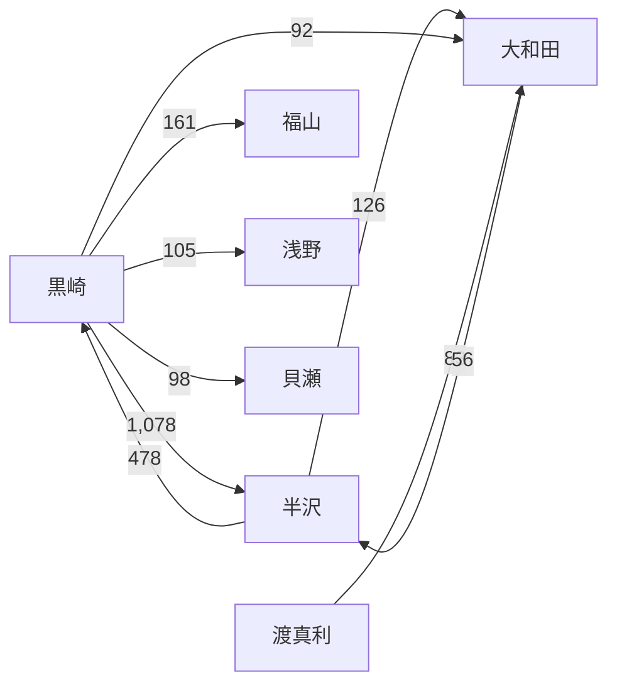

# シミュレーションの結果

2013年版「半沢直樹」最終回の直後（2013年10月）から10年間（2023年9月まで）を10万回シミュレーションした結果です。仕組みは [method.md](method.md) にあります。

特に断りのない数値は、Sonnet の回答から学習した方策による10万回の結果です。10万回の試行では、ある結果の確率の95%信頼区間の半幅は最大でも ±0.31 ポイントです。数値の元データは [data/results/sonnet/](../data/results/sonnet/) にあります。

> この結果は、作中の設定・独自に決めた規則・LLM の回答の3つから計算したものです。ドラマの続きの予想や、実在の銀行の分析ではありません。

## 目次

1. [要点](#1-要点)
2. [10年後の状態](#2-10年後の状態)
3. [人物ごとの結果](#3-人物ごとの結果)
4. [頭取の推移と後継](#4-頭取の推移と後継)
5. [対立の構造](#5-対立の構造)
6. [行動と動機](#6-行動と動機)
7. [介入実験](#7-介入実験)
8. [感度分析](#8-感度分析)
9. [モデルによる違い（Sonnet と Haiku）](#9-モデルによる違いsonnet-と-haiku)
10. [完全LLMランの1試行](#10-完全llmランの1試行)
11. [2020年版との照合](#11-2020年版との照合)
12. [結果を読むときの注意](#12-結果を読むときの注意)

---

## 1. 要点

1. **半沢直樹が10年以内に役員になる確率は 24.1%、頭取になる確率は 0%。** 10年後に最も多いのは部長（32.6%）で、執行役員・取締役が 21.0%、出向が 17.3%、失脚が 5.3%
2. **半沢の後退の最大の引き金は、金融庁の黒崎駿一による告発（56.6% の試行で起きる）。** 処分の元になった秘密の大半は、半沢自身の「疎開資料」の件だった
3. **このモデルでの権力闘争の中心は、半沢と大和田ではなく、半沢と黒崎の間の対立。** 互いを処分に追い込む件数が、他のどの組よりも桁違いに多い
4. **中野渡頭取の後継は、ほぼすべてドラマに登場しない人物**（旧東京第一銀行出身 54%、旧産業中央銀行出身 45%）。ドラマの人物では、大和田 0.6%、高木 0.5%
5. **介入実験では、半沢の役員到達率を最も大きく下げたのは、疎開資料の件が最初に公になること（−9.2 ポイント）と、中野渡が直後に退任すること（−5.2 ポイント）。** 大和田がいなくなっても半沢はほとんど変わらず、代わりに黒崎が −10.9 ポイント下がった
6. **感度分析で9個のパラメータを 0.5〜1.5倍に変えても、半沢の役員到達率は ±2 ポイント以内でしか変わらなかった。** 一方、LLM を Haiku に替えると 12.6% になり、モデルの選び方の影響が最も大きかった

---

## 2. 10年後の状態

2023年9月時点の状態の分布（%）です。「役員経験」は10年間に一度でも執行役員以上（ランク5以上）になった割合です。2013年時点ですでに役員だった大和田・中野渡・高木・岸川は、役員経験が100%になります。

| 人物 | 頭取 | 副頭取・専務・常務 | 取締役・執行役員 | 部長 | 次長以下 | 出向 | 転籍 | 退職・退任 | 失脚 | 役員経験 | 頭取経験 |
|---|---|---|---|---|---|---|---|---|---|---|---|
| 半沢直樹 | 0.0 | 0.0 | 21.0 | 32.6 | 10.4 | 17.3 | 5.7 | 7.6 | 5.3 | 24.1 | 0.0 |
| 大和田暁 | 0.6 | 0.0 | 0.0 | 0.0 | 0.0 | 0.0 | 9.2 | 86.9 | 3.3 | 100.0 | 1.4 |
| 中野渡謙 | 0.0 | 0.0 | 0.0 | 0.0 | 0.0 | 0.0 | 0.0 | 100.0 | 0.0 | 100.0 | 98.8 |
| 渡真利忍 | 0.0 | 0.0 | 34.2 | 40.3 | 4.7 | 11.9 | 0.1 | 8.2 | 0.6 | 35.1 | 0.0 |
| 近藤直弼 | 0.0 | 0.0 | 19.3 | 44.1 | 8.2 | 22.6 | 0.1 | 5.2 | 0.4 | 19.7 | 0.0 |
| 内藤寛 | 0.0 | 0.0 | 0.0 | 0.0 | 0.0 | 0.0 | 71.9 | 27.9 | 0.2 | 13.6 | 0.0 |
| 高木 | 0.5 | 0.0 | 0.0 | 0.0 | 0.0 | 0.0 | 0.2 | 99.1 | 0.2 | 100.0 | 3.9 |
| 岸川慎吾 | 0.0 | 0.0 | 0.0 | 0.0 | 0.0 | 0.0 | 28.6 | 71.0 | 0.4 | 100.0 | 0.0 |
| 福山啓次郎 | 0.0 | 0.0 | 9.9 | 58.8 | 7.7 | 3.5 | 0.2 | 15.4 | 4.4 | 10.1 | 0.0 |
| 浅野匡 | 0.0 | 0.0 | 0.0 | 0.0 | 0.0 | 0.0 | 70.7 | 16.3 | 13.1 | 0.0 | 0.0 |
| 小木曽忠生 | 0.0 | 0.0 | 0.1 | 0.1 | 0.3 | 2.8 | 75.1 | 20.8 | 0.9 | 0.2 | 0.0 |
| 江島浩 | 0.0 | 0.2 | 2.8 | 1.9 | 1.5 | 13.2 | 56.7 | 22.8 | 0.9 | 4.0 | 0.0 |
| 貝瀬郁夫 | 0.0 | 0.2 | 0.0 | 0.0 | 0.0 | 0.0 | 72.2 | 25.6 | 2.1 | 9.3 | 0.0 |
| 古里則夫 | 0.0 | 0.0 | 0.0 | 0.0 | 0.0 | 0.0 | 78.3 | 20.9 | 0.8 | 0.0 | 0.0 |

黒崎駿一（金融庁）の10年後: 主任統括検査官 25.8%、課長 22.8%、統括検査官 21.6%、主任検査官 12.6%、審議官 12.1%、検査官 4.0%、失脚 1.1%。

2013年に50歳を超えていた人物（内藤、浅野、小木曽、江島、貝瀬、古里など）の多くが、10年後に転籍か退職になっています。これは年次による出向と定年の規則によるもので、権力闘争の結果ではありません。

---

## 3. 人物ごとの結果

### 半沢直樹

| 10年間の最高の役職 | 割合 |
|---|---|
| 次長 | 16.4% |
| 部長 | 59.5% |
| 執行役員 | 19.3% |
| 取締役 | 4.8% |
| 常務以上 | 0.0% |

- **出向からの復帰は早い。** 中野渡頭取の後ろ盾が強いため、2015年4月までに 87% の試行で銀行本体へ戻り、その後部長に昇進する
- **後退の引き金**（その引き金が1回以上起きた試行の割合）:

  | 引き金 | 割合 |
  |---|---|
  | 黒崎の告発による処分 | 56.6% |
  | 黒崎が指揮する金融庁検査での発覚 | 35.0% |
  | 年次による出向 | 19.7% |
  | 自主退職 | 7.6% |
  | 黒崎を告発して失敗したことによる処分 | 7.3% |

- **処分の元になった秘密**は、疎開資料の件（S5）が大半で、岸川を脅して証言させた件（S6）がそれに次ぐ。疎開資料の件は、初期状態では黒崎が弱い証拠（0.2）しか持っていない。黒崎は証拠収集を繰り返して証拠を強め、検査や告発で公にする
- **役員に選ばれたときの勝因**（次点の候補との点数の差の平均）は業績（+0.50）と能力（+0.24）。処分歴（−0.32）は不利に働いている
- **頭取にはならない。** 頭取の候補は常務以上で、常務に就く年齢の目安は55歳である。半沢は2023年でも52歳なので、10年以内に頭取になることは、年齢の規則のためほぼありえない

### 大和田暁

- 10年間の最高の役職は、取締役のまま 67.5%、常務に返り咲き 24.7%、専務 5.6%、副頭取 0.7%、頭取 1.4%
- 10年後は退職・退任が 86.9%。取締役の定年（60歳）に2017年に達するため、常務以上に戻らなければ退任する
- 後退の引き金は、定年 68.0%、自主退職 18.1%、半沢の告発による処分 12.3%。処分の元になった秘密は、ほぼすべてが近藤に報告書を渡させた件（S4）
- 頭取として人事を行うときは、同じ派閥の候補を強く好み（重み 0.65）、処分歴の減点が最も小さい

### 中野渡謙

- 頭取の在任の割合は、2014年 85.9%、2016年 63.0%、2018年 45.2%、2020年 21.2%、2022年 9.2%
- 退任の理由は、通常の退任 80.3%、自主退職 9.4%、派閥の過去の不祥事の責任 6.9%、大型案件の失敗 3.3%（その理由が起きた試行の割合）。不祥事の責任をとって辞任する試行は 10.3%
- 半沢の後ろ盾として働いている。中野渡が直後に退任すると、半沢の役員到達率は 5.2 ポイント下がる（[7. 介入実験](#7-介入実験)）

### 渡真利忍

- 役員経験 35.1% で、同期3人（半沢、渡真利、近藤）のうち最も高い
- 10年後は部長 40.3%、執行役員・取締役 34.2%
- 後退の引き金は年次による出向 14.6%、大型案件の失敗 8.4% で、処分による後退は少ない。敵が少なく、告発の対象になりにくい
- 行動は業務専念 43%、支援 22%、根回し 15%、証拠収集 11%

### 近藤直弼

- 役員経験 19.7%、10年後は部長 44.1%、出向 22.6%
- 後退の引き金は年次による出向 26.6% が最も多い
- 行動は業務専念 60%、静観 17%、支援 13%。対立に関わる行動が少ない

### 黒崎駿一

- 金融庁で課長以上になる確率は 38.6%
- 半沢の告発による処分が 40.1% の試行で起きる
- 他人の処分の原因になった件数が最も多い人物（1,000試行あたり 1,660件）で、半沢・福山・浅野・貝瀬・大和田の処分の原因になっている。浅野の5,000万円の件（重大度0.9）を検査で見つけると、刑事告発になることが多い

### 内藤寛・高木・岸川慎吾

- 内藤は10年後に転籍 71.9%。2013年に54歳（俳優の生年で代用）のため、部長の年次による出向（53歳以上）の対象になる
- 高木は専務の定年（63歳）で退任する試行が大半。頭取経験 3.9%
- 岸川は2013年に60歳で出向中のため、最初の半期で退職する

### 浅野匡・福山啓次郎・その他

- 浅野は転籍 70.7%、失脚 13.1%。失脚の多くは、黒崎の検査で5,000万円の件が見つかることによる
- 福山は部長 58.8%、役員経験 10.1%。黒崎の検査で処分される試行が 15.8% あり、元になる秘密の大半は偽の疎開資料の件（S9）
- 小木曽、江島、貝瀬、古里は、年齢の規則で大半が転籍する

---

## 4. 頭取の推移と後継

毎年9月末時点の頭取（%、上位3人）:

| 年 | 1位 | 2位 | 3位 |
|---|---|---|---|
| 2014 | 中野渡 85.9 | 旧T出身の人物 6.4 | 旧S出身の人物 6.0 |
| 2015 | 中野渡 73.6 | 旧T出身の人物 12.2 | 旧S出身の人物 11.6 |
| 2016 | 中野渡 63.0 | 旧T出身の人物 17.4 | 旧S出身の人物 16.4 |
| 2017 | 中野渡 53.5 | 旧T出身の人物 22.4 | 旧S出身の人物 21.0 |
| 2018 | 中野渡 45.2 | 旧T出身の人物 26.9 | 旧S出身の人物 25.0 |
| 2019 | 旧T出身の人物 34.7 | 旧S出身の人物 31.3 | 中野渡 31.2 |
| 2020 | 旧T出身の人物 40.3 | 旧S出身の人物 35.8 | 中野渡 21.2 |
| 2021 | 旧T出身の人物 44.6 | 旧S出身の人物 39.2 | 中野渡 14.2 |
| 2022 | 旧T出身の人物 47.9 | 旧S出身の人物 41.4 | 中野渡 9.2 |
| 2023 | 旧T出身の人物 53.6 | 旧S出身の人物 45.3 | 大和田 0.6 |

「旧T出身の人物」「旧S出身の人物」は、ドラマに登場しない人物です。

後継がほぼすべてドラマに登場しない人物になるのは、候補者の構成によります。頭取の候補は常務・専務・副頭取（計11席）から選びます。2013年時点でこの11席に座っているドラマの人物は、高木（専務、60歳）だけです。高木は専務の定年（63歳）が近く、大和田は常務に戻らなければ候補になりません。

---

## 5. 対立の構造

「A が B の処分の原因になった」件数（1,000試行あたり。降格・出向・解任・刑事告発の合計で、1つの試行で複数回起きることがある）の上位です。

| 原因の人物 → 処分を受けた人物 | 1,000試行あたり | 主な内訳 |
|---|---|---|
| 黒崎 → 半沢 | 1,078 | 降格 594、出向 437、解任 47 |
| 半沢 → 黒崎 | 478 | 出向 283、降格 185 |
| 黒崎 → 福山 | 161 | 出向 84、降格 42、解任 36 |
| 半沢 → 大和田 | 126 | 降格 74、出向 42 |
| 黒崎 → 浅野 | 105 | 刑事告発 59、解任 38 |
| 黒崎 → 貝瀬 | 98 | 出向 53 |
| 黒崎 → 大和田 | 92 | 降格 50 |
| 渡真利 → 大和田 | 83 | 降格 52 |
| 大和田 → 半沢 | 56 | |

原因になった件数の合計は、黒崎が 1,660、半沢が 657 で、この2人が他の人物（大和田 89、渡真利 83）より桁違いに多くなっています。

黒崎と半沢の間の件数が、他の組より桁違いに多くなっています。理由は次のとおりです。

- 半沢は黒崎の婚約の件（S3）の強い証拠（0.8）を持っている
- 黒崎は半沢の疎開資料の件（S5）の弱い証拠を持ち、証拠収集で強めていく
- 黒崎は金融庁の検査を指揮でき、検査での発覚の確率は検査官が持つ証拠の強さとともに上がる
- 大和田は処分済みの大きな不正（S1）以外では、S4（重大度0.5）しか弱みがない

---

## 6. 行動と動機

### 行動の頻度（10万回の全期間、%）

| 人物 | 業務 | 静観 | 隠蔽 | 不正 | 退職 | 証拠収集 | 告発 | 取引 | 妨害 | 根回し | 支援 |
|---|---|---|---|---|---|---|---|---|---|---|---|
| 半沢直樹 | 42 | 4 | 2 | 0 | 0 | 22 | 5 | 1 | 2 | 7 | 16 |
| 大和田暁 | 22 | 20 | 12 | 1 | 2 | 12 | 0 | 2 | 5 | 23 | 0 |
| 中野渡謙 | 64 | 11 | 0 | 0 | 1 | 0 | 0 | 0 | 0 | 0 | 24 |
| 渡真利忍 | 43 | 7 | 0 | 0 | 0 | 11 | 1 | 0 | 0 | 15 | 22 |
| 近藤直弼 | 60 | 17 | 0 | 0 | 0 | 2 | 0 | 0 | 0 | 7 | 13 |
| 内藤寛 | 58 | 11 | 0 | 0 | 1 | 2 | 0 | 0 | 0 | 12 | 15 |
| 黒崎駿一 | 28 | 7 | 6 | 1 | 0 | 28 | 5 | 1 | 7 | 17 | 1 |
| 浅野匡 | 20 | 25 | 15 | 2 | 2 | 10 | 0 | 0 | 4 | 16 | 6 |

半沢は業務専念と証拠収集が多く、告発は5%です。告発は証拠が十分なときだけ選び、それ以外は証拠を集め続けます。大和田は根回し・静観・隠蔽が多く、表立った攻撃は少なくなっています。

### 回答の理由に表れた動機（%）

LLM が行動の理由として書いた文を、語のパターンで6種類に分類しました。1つの理由が複数に当てはまることがあります。

| 人物 | 報復・追及 | 保身 | 組織・融和 | 出世・地位 | 仲間・部下 | 業務・成果 |
|---|---|---|---|---|---|---|
| 半沢直樹 | 35 | 28 | 1 | 1 | 88 | 99 |
| 大和田暁 | 50 | 58 | 0 | 32 | 1 | 30 |
| 中野渡謙 | 0 | 0 | 95 | 0 | 4 | 87 |
| 渡真利忍 | 0 | 30 | 0 | 12 | 25 | 99 |
| 黒崎駿一 | 33 | 55 | 0 | 16 | 0 | 55 |
| 浅野匡 | 0 | 80 | 0 | 0 | 0 | 18 |
| 小木曽忠生 | 2 | 85 | 0 | 2 | 0 | 32 |

理由の例（Sonnet）:

- 半沢「攻撃を受けた直後でも、まず目の前の仕事で結果を出し、部下や渡真利ら仲間を守る。同時に父の仇の大和田については、証拠がまだ十分でないので、決定打になるよう情報を集め続ける。」
- 大和田「定年まで約1年で後ろ盾も弱い今は、頭取の好意を保ちつつ本業で実績を示し、派閥の立て直しを静かに図るのが得策だ。半沢への屈辱は忘れないが、握る弱みはなく、軽率に動けば自滅する。」
- 中野渡「頭取として銀行の安定と信用を第一に、静かに本業の舵取りを続ける。半沢のような次世代の人材は支え育てたいが、表立った動きは控える。」

### 頭取としての人事の好み

頭取になりうる4人に、属性の違う2人の候補のどちらを選ぶかを答えさせ、属性の重みを推定しました（正の値ほど重視）。

| 頭取 | 同じ派閥 | 業績 | 能力 | 自分との関係 | 処分歴 | 若すぎる | 他の役員の支持 |
|---|---|---|---|---|---|---|---|
| 中野渡 | 0.16 | 0.52 | 0.67 | 0.42 | −0.28 | −0.34 | 0.32 |
| 高木 | 0.62 | 0.39 | 0.54 | 0.71 | −0.53 | −0.18 | 0.27 |
| 大和田 | 0.65 | 0.26 | 0.40 | 0.67 | −0.20 | −0.37 | 0.43 |
| 内藤 | 0.17 | 0.31 | 0.64 | 0.64 | −0.49 | −0.18 | 0.60 |

大和田と高木は同じ派閥の候補を強く好み、中野渡と内藤はあまり重視しません。中野渡は業績と能力を最も重視します。

---

## 7. 介入実験

最初の半期に1つの出来事だけを強制的に起こし（または、ある人物にある行動を禁じ）、それ以外の乱数は基準シナリオと同じにして1万組を比べました。値は役員到達率の変化（ポイント）で、± は95%信頼区間の半幅です。黒崎の列は、金融庁で課長以上になる確率の変化です。

| 介入 | 半沢 | 渡真利 | 近藤 | 内藤 | 黒崎 |
|---|---|---|---|---|---|
| 浅野の5,000万円の件が公になる | −0.2±0.4 | +0.1±0.3 | −0.1±0.3 | 0.0 | −0.1±0.3 |
| 黒崎の婚約の件が公になる | +0.1±0.6 | +0.2±0.3 | +0.1±0.3 | 0.0 | −35.5±1.0 |
| 大和田と近藤の取引が公になる | +1.3±0.7 | +1.5±0.7 | +0.1±0.5 | +1.3±0.3 | −2.7±0.5 |
| 半沢の疎開資料の件が公になる | **−9.2±0.9** | +1.0±0.6 | +1.2±0.5 | −0.1±0.2 | +13.7±0.8 |
| 中野渡が直後に退任 | **−5.2±0.9** | +4.2±0.9 | +2.4±0.8 | +2.3±0.7 | +3.7±0.7 |
| 大和田が直後に退職 | +0.9±0.8 | +3.8±0.8 | +0.6±0.6 | +4.7±0.5 | −10.9±0.8 |
| 半沢が告発しない | +1.4±0.6 | +0.1±0.4 | +0.2±0.3 | −0.1±0.1 | +13.8±0.7 |
| 渡真利が半沢を支援しない | −2.8±0.4 | +3.5±0.8 | +0.7±0.4 | −0.1±0.1 | −0.1±0.3 |

### 読み取れること

- **疎開資料の件は半沢の最大の弱み。** 最初に公になると、半沢の役員到達率は 9.2 ポイント下がり、10年後に転籍している確率が 29.6 ポイント上がる。黒崎は、半沢から告発される回数が減るため 13.7 ポイント上がる
- **中野渡は半沢の後ろ盾。** 中野渡が直後に退任すると、半沢は 5.2 ポイント下がる。渡真利・近藤・内藤はむしろ上がる。中野渡の後ろ盾がなくなると半沢の昇進が遅れ、他の候補の機会が増える
- **大和田がいなくなっても、半沢はほとんど変わらない**（+0.9、信頼区間は0を含む）。代わりに黒崎が 10.9 ポイント下がる。大和田がいないと、半沢の最も強い敵意が黒崎に向き、半沢が原因となった黒崎の処分が1万試行あたり 4,811件から 6,703件に増える（+39%）
- **半沢が告発をやめると、半沢自身は 1.4 ポイント上がる。** 告発には、失敗したときに自分が処分される危険と、相手の敵意を強める作用がある。その分が半沢自身の昇進には不利に働いていると考えられる（この内訳はまだ分解していない）。黒崎は告発されなくなるため 13.8 ポイント上がる
- **渡真利が半沢を支援しないと、半沢は 2.8 ポイント下がり、渡真利は 3.5 ポイント上がる。** 支援は、支援する側が自分の業務に使う時間を削る

平均の効果が小さくても、個々の試行の結果は変わります。たとえば浅野の件が公になると、平均の効果はほぼ0ですが、半沢の10年後の状態が変わった試行は 7.6% ありました。1つの出来事が、その後の人事の順番を通じて別の結果につながるためです。

---

## 8. 感度分析

不確かなパラメータ9個を1つずつ基準値の 0.5倍と 1.5倍（出向からの復帰の基準値は ±0.5）に変え、基準シナリオと同じ乱数で5千組を比べました。値は役員到達率の変化（ポイント）です。

| パラメータ（0.5倍 / 1.5倍） | 半沢 | 渡真利 | 近藤 | 内藤 |
|---|---|---|---|---|
| 金融庁検査の頻度 | +1.3 / −1.2 | −0.4 / +0.6 | −0.4 / 0.0 | −0.2 / +0.1 |
| 偶発的な露見の率 | −0.3 / +0.1 | −0.1 / +0.1 | 0.0 / +0.1 | −0.1 / +0.1 |
| 大型案件の失敗の率 | +0.1 / +0.2 | +0.9 / −1.4 | +0.5 / −0.4 | −0.9 / +0.6 |
| 派閥の過去の不祥事の率 | +0.1 / −0.1 | −0.1 / −0.1 | +0.1 / 0.0 | −0.1 / +0.1 |
| 後継指名での取締役会の重み | −0.3 / +0.3 | −0.1 / +0.2 | −0.3 / 0.0 | 0.0 / −0.1 |
| 出向からの復帰のしやすさ（−0.5 / +0.5） | −1.2 / +0.7 | −0.1 / +0.3 | +0.5 / −0.1 | 0.0 / 0.0 |
| 年次による出向の率 | +1.1 / +0.2 | +1.8 / −0.2 | +1.1 / −0.2 | +5.1 / −4.2 |
| 頭取の退任の率 | +0.7 / 0.0 | −0.6 / +0.3 | −0.6 / +0.7 | −0.2 / +0.3 |
| 人事の選択の温度（小さいほど点数どおりに選ぶ） | +2.0 / 0.0 | +3.6 / −1.8 | +2.0 / −0.6 | −0.5 / +0.4 |

半沢の役員到達率（24.1%）は、どのパラメータを変えても ±2 ポイントの範囲に収まりました。金融庁検査の頻度が高いほど半沢が不利になるのは、疎開資料の件が検査で見つかりやすくなるためです。内藤は年次による出向の率に強く影響されます。

ここで変えていない要素のうち、年齢の規則（就任の年齢の目安、年次による出向の年齢、役員の定年）と、方策を学習した LLM のモデルは、結果をより大きく変える可能性があります。

---

## 9. モデルによる違い（Sonnet と Haiku）

同じカードに Haiku でも答えさせ、Haiku の回答から学習した方策で2万回を実行しました。

| 指標 | Sonnet の方策（10万回） | Haiku の方策（2万回） |
|---|---|---|
| 半沢の役員到達率 | 24.1% | 12.6% |
| 半沢の10年後の失脚 | 5.3% | 10.6% |
| 渡真利の役員到達率 | 35.1% | 25.0% |
| 近藤の役員到達率 | 19.7% | 12.8% |
| 黒崎の金融庁課長以上 | 38.6% | 27.5% |
| 渡真利の自主退職（起きた試行の割合） | 8.2% | 22.1% |
| 近藤の自主退職 | 5.2% | 29.3% |
| 半沢の行動（業務専念・告発・妨害） | 42%・5%・2% | 22%・13%・6% |

- Haiku の半沢は、業務より告発や妨害を多く選び、その分だけ昇進から遠ざかる。黒崎との互いの告発も増える
- Haiku の渡真利と近藤は、銀行を辞める行動を多く選ぶ
- Sonnet と Haiku の同じカードへの回答の差（全変動距離 0.256）は、どちらのモデルの再回答の差（Sonnet 0.047、Haiku 0.112）よりも大きい

半沢の役員到達率は、感度分析で変えたどのパラメータよりも、LLM のモデルの選び方で大きく変わりました。どちらの回答が「半沢直樹らしい」かは判定していません。ペルソナの記述（「保身や派閥の論理を嫌う」「目的のためには強引な手段もいとわない」）は、どちらの解釈も許します。

---

## 10. 完全LLMランの1試行

方策モデルを使わず、全員の行動を毎半期 Sonnet に決めさせた試行を1回実行しました（189回の呼び出し）。各人物には、状況カードに加えて、その人物が知りうる「これまでの出来事」を渡しています。経過（名前付きの人物の主な出来事）:

| 時期 | 出来事 |
|---|---|
| 2013年10月 | 半沢が出向から銀行に復帰（次長）。岸川が退職 |
| 2014年4月 | 渡真利が次長に昇進。黒崎が統括検査官に昇進。内藤が年次による出向 |
| 2014年10月 | 半沢が部長に昇進。内藤が転籍 |
| 2015年4月 | 金融庁検査で半沢の不正が発覚し、解任（失脚）。同じ半期に渡真利が大和田の不正を告発して成功し、大和田は執行役員に降格 |
| 2015年10月 | 近藤が次長に昇進 |
| 2016年4月 | 高木が退職 |
| 2016年10月 | 渡真利が部長に昇進 |
| 2017年4月 | 大和田が退職 |
| 2019年4月 | 近藤が部長に昇進 |
| 2020年4月 | 中野渡が頭取を退任 |
| 2021年4月 | 福山が部長に昇進 |
| 2022年4月 | 黒崎が審議官に昇進 |

10年後: 半沢は失脚、渡真利・近藤・福山は部長、黒崎は審議官。この試行での半沢の結果は、10万回の分布では 5.3% にあたります。全経過は [data/fullrun/sonnet-0/timeline.md](../data/fullrun/sonnet-0/timeline.md)、各人物の回答と理由は [records.json](../data/fullrun/sonnet-0/records.json) にあります。

この試行で実際に現れた状態での、LLM の回答と方策モデルの差は全変動距離 0.105 でした（検証用カードでは 0.078）。

---

## 11. 2020年版との照合

2020年版の物語は2013年版の最終回から1〜2年後の出来事です。2020年版の内容はモデルの入力に使っていません。2015年4月時点で、劇中の事実が成り立つ試行の割合を数えました（2万回）。

| 劇中の事実 | Sonnet | Haiku |
|---|---|---|
| 半沢が出向から銀行本体に復帰 | 86.8% | 84.1% |
| 半沢が銀行本体の次長 | 27.8% | 28.2% |
| 渡真利が次長 | 50.3% | 45.5% |
| 近藤が次長 | 39.3% | 36.4% |
| 大和田が取締役のまま | 83.8% | 71.0% |
| 中野渡が頭取のまま | 84.2% | 80.7% |
| 内藤が部長のまま | 37.8% | 37.2% |
| 福山が次長のまま | 85.2% | 84.7% |
| 黒崎が金融庁に在籍 | 100.0% | 99.9% |

多くの事実に高い確率がつきました。低かったのは2つです。

- 半沢が次長のまま（28%）: 復帰後に部長へ昇進する試行が多く、昇進が劇中より速い
- 内藤が部長のまま（38%）: 年齢を俳優の生年で代用したため、年次による出向の対象になる

---

## 12. 結果を読むときの注意

- 結果は、作中の設定、独自に決めた規則とパラメータ、LLM の回答の3つから計算したもので、ドラマの続きの予想ではない
- 規則とパラメータは作品の場面と日本の大手銀行の慣行を参考に決めたもので、データから推定したものではない。感度分析で主な9個の影響を示した
- 年齢の規則の影響は大きい。半沢の頭取 0%、内藤らの転籍の多さは、主に年齢の規則による
- LLM は作品を知っており、人物名を伏せると回答が変わる（全変動距離 0.123。再回答の差 0.056 の約2倍）。回答には、ペルソナに加えて LLM が知っている人物像が入っている
- LLM のモデルを替えると結果が大きく変わる（半沢の役員到達率 24.1% と 12.6%）
- 処分の判断は、頭取4人の間の違いを推定できるだけのデータがなかった
- 後退の引き金と昇進の要因は、モデルの中での関連の記述である。因果効果として述べているのは介入実験の結果だけ
